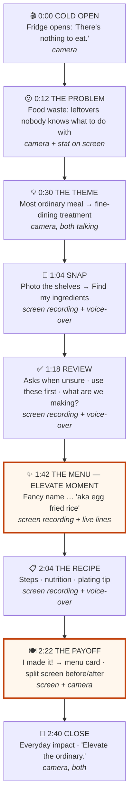

# Fridge Chef: full video script (2 people, about 2:56, no cooking)

**A** = the "nothing to eat" person (on camera, holds the phone).
**B** = the "chef" voice (on camera for the talking parts, voice-over for the app parts).
Replace `[A]` and `[B]` with your names. Anything in `[brackets]` = read the real value off your app on the day.

---

## 1. What we're saying (read this before filming)

**What the app does, in one sentence:**
Fridge Chef looks at a photo of your fridge, works out what's in it, and turns those leftovers into three restaurant-style dishes you can make tonight, using only what you already have.

**Why it fits "Elevate the ordinary":**
The most ordinary meal of the week is the leftover dinner: whatever's in the fridge, eaten standing at the counter. Fridge Chef gives that meal the fine-dining treatment. It elevates three ordinary things:

| Ordinary thing | How it's elevated |
|---|---|
| **Ordinary ingredients** (eggs, rice, half an onion) | become a dish with a restaurant menu name: "Golden Wok-Tossed Rice…", *aka* egg fried rice |
| **An ordinary kitchen** (no shopping, no special gear) | gets a real recipe with steps and a plating tip, so it looks restaurant-worthy |
| **An ordinary cook** (you, tired, on a Tuesday) | ends the night with a menu card: *"Tonight at [A] & [B]'s Kitchen"* |

**How it changes everyday life:**
- **Less waste:** it finds what's about to go off and builds dinner around it. The card counts the leftovers you rescued.
- **Less money:** you cook what you already bought, instead of ordering takeaway or doing another shop.
- **Less decision fatigue:** it answers "what can I even make?" in under a minute.
- **Eating better:** every dish shows calories and protein, and you can steer it (high protein, quick snack, dinner for 4).
- **Feeling good about it:** a normal weeknight meal feels like an occasion, and something you'd share.

**The one line to remember:** *"From 'nothing to eat' to a restaurant night at home, with what's already in your fridge."*

---

## 2. How the video flows

**The story arc:** ordinary moment → why it matters → our idea → the app proving it, step by step → the elevated result → why it matters every day.

---

## 3. What to film (shot list)

**Camera shots** (partner's phone held **sideways / landscape**, in the kitchen; the final video is 16:9):

| # | Shot | Used in |
|---|---|---|
| C1 | Fridge door swinging open, slow pan across the half-empty shelves. Hold 3 seconds on the inside of the fridge (this frame is reused for the split screen). | Cold open, payoff |
| C2 | A at the open fridge, sighing, delivering the cold-open lines | Cold open |
| C3 | B holding up the saddest item, talking to camera | Problem |
| C4 | Both at the counter, phone in A's hand, talking to camera | Theme |
| C5 | Over A's shoulder: A taking photos of the shelves with the app | Snap |
| C6 | Both on camera, A holding the phone up with the menu card facing the lens | Close |

**Screen recordings** (A's iPhone: Control Center → Screen Recording, Do Not Disturb on):

| # | What to record | Used in |
|---|---|---|
| S1 | The full run in one take: Snap → photos → Find my ingredients → Review (scroll, answer one unsure item, pick Dinner / 2 people / Savory, type "date night") → Plan tonight's menu → Menu (scroll slowly) → Cook this → Recipe (scroll slowly, tick 2–3 steps) → I made it! → type names → menu card | Snap → payoff |
| S2 | A spare take of the menu and menu card screens, in case S1 has a mistake | Backup |

Go slower than feels natural: pause about 1 second on each screen before tapping. You'll cut the pauses in editing.

---

## 4. The full script

### SCENE 1 · Cold open (0:00–0:12) · *camera C1, C2*
**On screen:** the fridge door swings open on a half-empty fridge: a few eggs, a tub of leftover rice, some sad-looking veg, a half-used something.

> **A** *(sighs, to camera)*: "There's nothing to eat."
> **B** *(off camera, pointing)*: "There's eggs. There's rice. There's… that."
> **A**: "Yeah, that's not *dinner*."

**Text on screen:** *Sound familiar?*

### SCENE 2 · The problem (0:12–0:30) · *camera C3*
**On screen:** B on camera, holding up the saddest item from the fridge.

> **B**: "It's not that there's *nothing*. It's that nobody knows what to make with it. So the eggs wait. The rice waits. The veg goes soft… and it all goes in the bin. And that's happening in kitchens everywhere, every single week."

**Text on screen:** your food-waste statistic and its source, e.g. *"[X]% of food bought at home is wasted (source: [UNEP / WRAP])"*. Use a real figure.

### SCENE 3 · The theme (0:30–1:04) · *camera C4*
**On screen:** both at the counter, the phone in A's hand.

> **A**: "This hackathon's theme is *Elevate the ordinary*. So we asked what the most ordinary meal of the week is."
> **B**: "The leftover dinner. Whatever's in the fridge, eaten standing at the counter."
> **A**: "Fridge Chef takes that meal and gives it the fine-dining treatment. The same leftovers get a real recipe, a restaurant menu name and plating, and end the night on a menu card with your name on it."
> **B**: "Ordinary ingredients, ordinary kitchen, ordinary cook. All three get elevated."

**Text on screen** (one line at a time as B says them): *Ordinary ingredients ✓ · Ordinary kitchen ✓ · Ordinary cook ✓*

### SCENE 4 · Snap (1:04–1:18) · *camera C5, then screen S1*
**On screen:** start on C5 (A photographing the shelves), cut to the screen recording: the "Nothing to eat? Let's see about that." screen, photos appearing, tap **Find my ingredients**, loading screen (cut it short).

> **A** *(live, while taking photos)*: "Just snap what's there. One photo per shelf."
> **VO — B**: "And it actually reads the whole fridge, even the random tubs with no labels and the stuff that's been hiding at the back for way too long."

### SCENE 5 · Review (1:18–1:42) · *screen S1*
**On screen:** the Review screen. Scroll slowly past the ingredient chips, tap the **onion** and **milk** chips, and type "curry powder, yogurt" in the **Anything else?** box. Scroll to **What are we making?**, tap **Dinner**, type "very hungry" in the note to the chef, tap **Plan tonight's menu**.

> **VO — A**: "Okay, so this is what we're working with: chocolate almond candies, hot sauce, jam, some bread… and orange soda. We also had onion, milk, curry powder and yogurt in the cupboard, so we added those in."
> **VO — B**: "Honestly, I would've just ordered takeout. Instead, we told it we wanted dinner and that we were very hungry, and let it figure out the rest."

### SCENE 6 · The menu, the elevate moment (1:42–2:04) · *screen S1*
**On screen:** the Menu screen. Scroll slowly past all three dishes, then zoom in (in editing) on the fancy name of the **Creamy Curry Bread Panade** dish, then on the orange "aka" line under it.

> **VO — A** *(fancy voice)*: "Creamy Curry Bread Panade, with Golden Crust and Cooling Yogurt."
> **VO — B** *(flat)*: "…aka curry bread pudding."
> **VO — A**: "Okay, but it's *elevated* curry bread pudding! And everything in all three dishes was already in our kitchen, so there was nothing to buy."
> **VO — B**: "It even shows you how long each one takes and how much protein you're getting."

### SCENE 7 · The recipe (2:04–2:22) · *screen S1*
**On screen:** tap **Cook this**. Scroll slowly past the nutrition panel and ingredient list, tick 2–3 steps, stop on the **plating tip**.

> **VO — B**: "The steps are short enough to follow while you're actually cooking, and there's a plating tip at the end, because half of fancy is how it looks on the plate."
> **VO — A**: "And it never sneaks in something you don't have, because the app double-checks every recipe before you even see it."

### SCENE 8 · The payoff (2:22–2:40) · *screen S1, then split screen*
**On screen:** tap **I made it!**, type "Sid", and the menu card appears. Then the **split screen**: frame C1 (the half-empty fridge) on the left and the menu card on the right. Hold it for 3 seconds.

> **VO — A**: "We started with "there's nothing to eat"…"
> **VO — B**: "…and ended up with dinner at *Sid's Kitchen*. Six leftovers saved from the bin, and thirty minutes from fridge to plate."

**Text on screen** (over the split screen): *Before → After*

### SCENE 9 · Close (2:40–2:56) · *camera C6*
**On screen:** both on camera, A holding the phone up with the menu card facing the lens.

> **A**: "So next time you open the fridge and think there's nothing to eat…"
> **B**: "…there probably is. You just need Fridge Chef."
> **Both**: "Elevate the ordinary."

**End card (3 seconds):** **Fridge Chef** · *Elevate the ordinary* · [repo link] · [A] & [B]

---

## 5. Voice-over track (record in one sitting)

Record this in a quiet room, phone close to your mouth, while watching the screen recording if you can. Leave a 2-second gap between scenes so they're easy to cut apart. Cues in *italics* are not read out.

**How to say it:** talk like you're showing a friend something cool on your phone, not reading a script. Smile while you talk (it sounds warmer). Let the funny bits be funny: the orange soda, the takeout line, the "aka". If a line feels stiff in your mouth, say it your own way; the meaning matters more than the exact words.

*— Scene 4: Snap —*
**B:** And it actually reads the whole fridge, even the random tubs with no labels and the stuff that's been hiding at the back for way too long.

*— Scene 5: Review —*
**A** *(a bit embarrassed)*: Okay, so this is what we're working with: chocolate almond candies, hot sauce, jam, some bread… and orange soda. We also had onion, milk, curry powder and yogurt in the cupboard, so we added those in.
**B** *(laughing)*: Honestly, I would've just ordered takeout. Instead, we told it we wanted dinner and that we were very hungry, and let it figure out the rest.

*— Scene 6: Menu —*
**A** *(fancy)*: Creamy Curry Bread Panade, with Golden Crust and Cooling Yogurt.
**B** *(flat)*: …aka curry bread pudding.
**A** *(proud)*: Okay, but it's *elevated* curry bread pudding! And everything in all three dishes was already in our kitchen, so there was nothing to buy.
**B:** It even shows you how long each one takes and how much protein you're getting.

*— Scene 7: Recipe —*
**B:** The steps are short enough to follow while you're actually cooking, and there's a plating tip at the end, because half of fancy is how it looks on the plate.
**A:** And it never sneaks in something you don't have, because the app double-checks every recipe before you even see it.

*— Scene 8: Payoff —*
**A:** We started with "there's nothing to eat"…
**B** *(warm, slower)*: …and ended up with dinner at Sid's Kitchen. Six leftovers saved from the bin, and thirty minutes from fridge to plate.

---

## 6. Editing it together (CapCut, free, on the Mac)

**Get the files onto the Mac.** AirDrop every clip from both phones (C1–C6 and the screen recording) into one folder, e.g. `Desktop/fridge-chef-video`. Record the voice-over with the Mac's mic in CapCut, or with **Voice Memos** on a phone and AirDrop it too.

1. **Set up:** install CapCut (capcut.com or the Mac App Store) and sign in. Click **Create project**, then **Import** and pick everything in the folder. Click **Ratio** under the preview and choose **16:9**.
2. **Rough cut:** drag the clips onto the timeline in order: C1, C2, C3, C4, C5, the screen recording, C6.
3. **Trim:** drag a clip's edge to shorten it. To cut out a middle part (like a loading wait), move the playhead there, press **⌘B** to split, select the bit you don't want and press **Delete**. Cut every wait down to about 1 second.
4. **Fit the phone recording:** the screen recording is tall, so it sits in the middle with empty sides. Select it, go to **Canvas → Background → Color** and choose a warm off-white (hex `#FFF7ED`) or **Blur**. It looks like a phone on a clean background.
5. **Voice-over:** click the 🎙 mic icon above the timeline, play the matching part and read the lines. Or drag in your Voice Memos file. Put each line under its scene, on its own track below the video.
6. **Zoom for the "aka" moment:** split the menu part of the screen recording around the fancy name, select that piece, and raise **Scale** to about 160%, moving it so the name and the "aka" line fill the frame.
7. **Text:** **Text → Default text**, drag it above the clip, type, and set the font and color. Add: *Sound familiar?* (scene 1), the food-waste stat with its source (scene 2), the three *Ordinary … ✓* lines (scene 3), *Before → After* (scene 8), and the end card.
8. **Split screen (scene 8):** right-click C1 where the fridge is clearest and choose **Freeze** (it makes a still frame). Put that still on the main track and the menu-card part of the screen recording on the track above, with the same length (3 seconds). Make each half the width (Scale about 50%) and slide the fridge left and the card right.
9. **Captions:** **Text → Auto captions → Create**. Read through and fix any wrong words, especially "Fridge Chef" and dish names. Judges often watch with the sound off.
10. **Music:** **Audio → Music**, pick something calm, drag it under everything, and set the volume to about 10–15%. Speech must stay clearly louder.
11. **Check:** watch it once start to finish with sound and once muted. It must be **under 3:00**. If it's long, trim scene 5 first; never the menu or the payoff.
12. **Export:** **Export** (top right) → 1080p, 30 fps, MP4. Then upload it to YouTube as **Unlisted** (or wherever the hackathon asks) and paste that link into the submission.

**Avoid anything marked "Pro"** in CapCut (some effects, fonts and templates). Free features export fine; Pro ones block the export or add a watermark.

---

## 7. How the video hits what judges look for

| Judges look for | Where the video shows it |
|---|---|
| **Fits the theme** | Scene 3 says it, scene 6 shows it ("aka [plain name]"), scene 8 proves it with the before/after |
| **Real problem and impact** | Scene 2 food waste; "use these first" in scene 5; "leftovers rescued" in scene 8; everyday impact in scene 9 |
| **It actually works** | A real fridge, analysed live, end to end, with real results |
| **Technical depth** | Vision across several photos, unsure-item questions, recipes limited to your ingredients, nutrition, native SwiftUI |
| **Memorable** | The fancy-voice "aka" joke and the before/after split screen |

---

## 8. Before you hit record

- [ ] **Fridge:** at least 4–5 real foods (e.g. eggs, leftover rice or pasta, cheese, an onion or any veg, something in a tub). Half-empty is good.
- [ ] **Test run:** do one full run with this exact fridge and write down the real values: [Item] to use first, [Fancy dish name], [plain name], [N] leftovers, [X] minutes.
- [ ] **Wake the server:** app → ⚙︎ → Test connection (can take a minute).
- [ ] **Phone:** Do Not Disturb on, battery charged, notifications off.
- [ ] **Never show** `server/.env`, the API key, or the chat with Claude on screen.
- [ ] **Food-waste stat:** found, with its source.
- [ ] **Audio:** quiet room, no fridge hum. Close the fridge door when talking.
